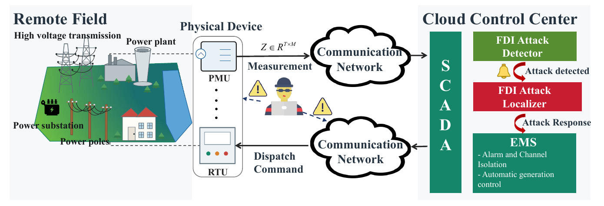
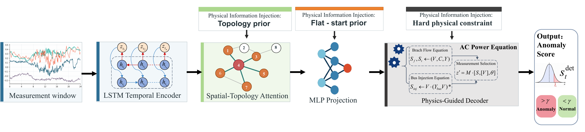
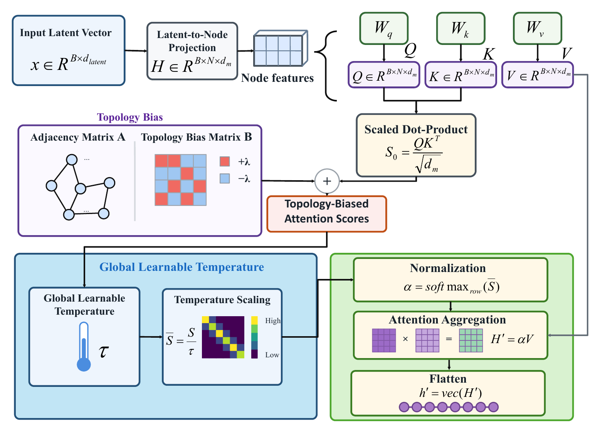
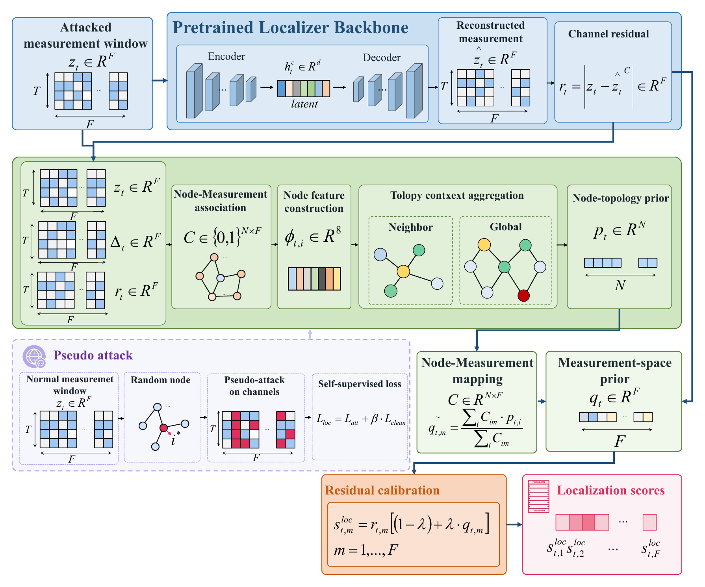

Research code for **Physics-Guided Detection and Topology-Calibrated
Measurement-Channel Localization of False Data Injection Attacks in Smart Grids**.

本仓库提供上述论文的研究代码，用于智能电网虚假数据注入
（False Data Injection，FDI）攻击的检测与量测通道定位。
文档和实验入口按照论文的叙述顺序组织，主要方法为 **PGAE-tau** 与 **TopoLoc-ConvAE**。

The repository includes model implementations, experiment notebooks, and a
synthetic CPU smoke test. Prepare training data using the [data guide](docs/DATA.md);
training saves checkpoints and evaluation generates results locally.

仓库包含模型实现、实验 Notebook 和基于合成输入的 CPU smoke test。
训练数据按[数据说明](docs/DATA.md)准备，模型权重与评估结果由运行实验生成。

## 1. Problem Setting / 问题背景

FDI attacks perturb power-grid measurements while exploiting the relationship
between voltage states and AC measurements. The task is to detect abnormal
measurement windows and rank suspicious measurement channels.

FDI 攻击利用电压状态与交流量测之间的关系构造量测扰动。本项目首先判断一个量测
时间窗口是否异常，再对可疑量测通道排序。定位对象是**量测通道**，
节点权重经节点与量测的关联关系映射为通道先验。



*Cyber-physical monitoring setting from the manuscript. / 论文中的信息物理监测场景。*

## 2. Methodology / 方法介绍

### 2.1 Detection and Localization Workflow / 检测与定位流程

1. Normalize chronological measurement windows using normal-training statistics.
   使用正常训练集的统计量，对按时间排列的量测窗口进行归一化。
2. Apply PGAE-tau to reconstruct the target measurements through a fixed AC
   decoder; use the reconstruction discrepancy for attack detection.
   PGAE-tau 经固定交流解码器重建目标量测，根据重建偏差进行攻击检测。
3. Apply TopoLoc-ConvAE to rank channels using ConvAE residuals calibrated by
   a learned node-topology prior.
   TopoLoc-ConvAE 利用节点拓扑先验校准 ConvAE 的通道残差，输出可疑通道排序。

Detection and localization have separate experiment entries. Localization
metrics are computed on attacked samples independently of detector decisions.

检测与定位分别设有实验入口。定位指标在受攻击样本上独立计算。

### 2.2 PGAE-tau Detector / 攻击检测器



*Temporal encoding, topology attention, voltage projection, and fixed AC
reconstruction. / 时间编码、拓扑注意力、电压投影与固定交流重建。*

The detector follows the order of the methodology section:

检测器依照论文方法部分的顺序实现：

| Module / 模块 | Role / 作用 | Implementation / 实现 |
| --- | --- | --- |
| Temporal feature encoding / 时间特征编码 | Bidirectional LSTM summarizes a measurement window. / 双向 LSTM 编码量测窗口。 | `TimeCompressor` |
| Spatial-Topology Attention / 空间拓扑注意力 | Bus embeddings interact with an adjacency-derived soft bias. / 节点表征通过带邻接偏置的注意力交互。 | `LatentTopoAttention` |
| Voltage projection and flat start / 电压投影与平启动 | Separate heads predict real/imaginary voltage; initialization starts near 1 + j0. / 两个输出头估计电压实虚部，初始状态接近 1 + j0。 | `FeatureCompressor`, `initialize_flat_start` |
| Fixed AC decoder / 固定交流解码器 | Reconstructs selected measurements from voltages and grid constants. / 用电压与电网常数重建所选量测。 | `PowerFlowPhysics`, `PI_Decoder` |
| Reconstruction training / 重建训练 | Normalized MSE at the last step of each normal window. / 正常窗口最后时刻的归一化重建均方误差。 | `PGAE_tau.fit` |

Attention uses `softmax((QK^T / sqrt(d) + B) / tau)`, where
`tau = abs(theta_tau) + eps`. The model learns **one scalar temperature shared
across all samples**. The bias is positive for adjacent buses and negative
otherwise; all bus pairs participate in attention. The AC decoder uses fixed
grid admittance and incidence matrices.

注意力采用上述温度缩放形式，**所有样本共享一个可学习标量温度**。
邻接节点对使用正偏置，其余节点对使用负偏置，所有节点对均参与注意力计算。
交流解码器使用固定的电网导纳矩阵与关联矩阵。

PGAE-tau detects attacks using normalized reconstruction error. The detection
notebook computes scores and validation quantiles; the
[experiment settings](docs/REPRODUCIBILITY.md#detection-settings--检测设置)
list each method's score and threshold selection.

PGAE-tau 根据归一化重建误差检测攻击。检测 Notebook 计算异常分数与验证集分位数，
各方法的评分和阈值选择方式见[检测设置](docs/REPRODUCIBILITY.md#detection-settings--检测设置)。

<details>
<summary>Shared-temperature attention / 共享温度注意力细节</summary>



The topology bias and content logits are scaled together. A smaller temperature
sharpens attention and a larger temperature smooths it.

拓扑偏置与内容相关的注意力分数一同缩放；温度较小时分布更集中，较大时更平滑。

</details>

Source / 源码：[models/detection/pgae_tau.py](models/detection/pgae_tau.py)。

### 2.3 TopoLoc-ConvAE Localizer / 量测通道定位器



*Frozen ConvAE residuals and a self-supervised topology prior. / 冻结的 ConvAE 残差与自监督拓扑先验。*

The localizer follows four steps:

定位器分为四个步骤：

1. **Residual extraction / 残差提取.** A pretrained, frozen ConvAE computes
   absolute channel residuals at the last time step.
   预训练且冻结的 ConvAE 提供最后时刻各量测通道的绝对重建残差。
2. **Node prior / 节点先验.** Pool eight features from current measurements,
   temporal differences, and residuals; combine local, neighbor, and global
   context to infer node weights.
   从当前量测、时间差分和残差汇聚八维特征，融合局部、拓扑邻居与全局信息以预测节点权重。
3. **Channel mapping and calibration / 通道映射与校准.** Map node weights
   through node-channel membership, normalize the channel prior, then use
   `score = residual * ((1 - lambda) + lambda * channel_prior)`.
   根据节点与量测通道的关联关系完成映射和归一化，再用上述公式校准残差并排序。
4. **Self-supervision / 自监督训练.** Apply coherent offsets, independent
   Gaussian offsets, or stale-value replacements to one sampled node's
   channels. The sampled node is a surrogate target; no annotated attack
   dataset is needed for prior training.
   在随机节点关联的通道上构造一致偏移、独立高斯偏移或历史值替换，以被选节点作为
   代理标签，不依赖人工标注的攻击训练集。

Fusion strength is selected by validation NDCG@15. Train ConvAE first and load
its `ConvAE.pt` checkpoint when training the prior. The backbone stays frozen
throughout prior training.

融合权重根据验证集 NDCG@15 选择。先训练 ConvAE，再加载 `ConvAE.pt` 训练拓扑先验，
训练期间骨干网络始终冻结。

Source / 源码：[topoloc_convae.py](models/localization/topoloc_convae.py)、
[self_supervision.py](models/localization/self_supervision.py)。

## 3. Installation and Smoke Test / 安装与最小测试

Use a dedicated environment. Python 3.13 is the locally validated interpreter.
Run the following from the repository root:

建议建立独立环境；本地验证使用 Python 3.13。在项目根目录执行：

```bash
python -m venv .venv
source .venv/bin/activate
python -m pip install --upgrade pip
python -m pip install -r requirements.txt
python smoke_test.py
```

On Windows, activate with `.venv\Scripts\activate`. For notebooks and optional
graph baselines, also install `requirements-optional.txt`.

Windows 使用 `.venv\Scripts\activate` 激活环境。运行 Notebook 或可选图模型基线时，
还需安装 `requirements-optional.txt` 中的依赖。

The CPU test generates temporary synthetic data, checks normalization, compares
the AC decoder with independent NumPy equations, checks shared-temperature and
localizer gradients, and verifies checkpoint save/load. Inputs and weights are
removed on exit.

CPU 测试临时生成合成数据，检查归一化、交流解码器与独立 NumPy 公式的一致性、共享温度
及定位网络的梯度，并验证权重保存和加载。退出后自动删除临时输入与权重。
可选择另外两个系统：

```bash
python smoke_test.py --case case30
python smoke_test.py --case case57
```

## 4. Experiments in Paper Order / 按论文顺序运行实验

Prepare real inputs according to [DATA.md](docs/DATA.md).
`PGAE_CASE` selects `case14`, `case30`, or `case57` and must be set before
project imports. Restart a notebook kernel when changing the case.

请先依据 [DATA.md](docs/DATA.md) 准备真实输入。必须在导入项目模块前设置 `PGAE_CASE`，
可选 `case14`、`case30`、`case57`，默认 `case30`；切换系统后应重启 Notebook 内核。

| Order / 顺序 | Paper / 论文章节 | Entry / 实验入口 |
| --- | --- | --- |
| 01 | IV. Experimental Setup / 实验设置 | [01_setup](experiments/01_setup/)、`configs/`、`data/` |
| 02 | V-A. Detection Performance / 检测性能 | [02_detection](experiments/02_detection/)、`train.py` |
| 03 | V-B. Measurement-Channel Localization / 量测通道定位 | [03_localization](experiments/03_localization/) |
| 04 | V-C. Ablation Study / 消融分析 | [04_ablation](experiments/04_ablation/)、定位评估中的融合权重扫描 |
| 05 | V-D. Efficiency Analysis / 效率分析 | [05_efficiency](experiments/05_efficiency/) |

For the core training and localization sequence:

核心训练与定位评估按以下顺序执行：

```bash
python train.py --model PGAE-tau --case case30
python train.py --model ConvAE --case case30
PGAE_CASE=case30 python experiments/03_localization/train_topoloc.py
PGAE_CASE=case30 python experiments/03_localization/evaluate_topoloc.py
PGAE_CASE=case30 python experiments/04_ablation/localization_controls.py
```

See the [experiment guide](experiments/README.md) for baseline notebooks,
result merging, dependencies, and ablation settings. A detailed
[paper-to-code map](docs/PAPER_TO_CODE.md) links each methodology subsection
to its implementation.

基线评估、结果合并、依赖关系和消融设置，详见
[实验指南](experiments/README.md)。[论文与代码对照表](docs/PAPER_TO_CODE.md)
逐项对应方法小节与代码实现。

## 5. Repository Layout / 项目结构

```text
PGAE-tau/
├── models/
│   ├── detection/          # III-B: PGAE-tau detector / 检测器
│   ├── localization/       # III-C: TopoLoc-ConvAE / 定位器
│   ├── baselines/          # Comparison methods / 比较方法
│   └── ablation/           # PGAE-LSTM comparison / 对照模型
├── data/                   # Generation, datasets, loaders / 生成与加载
├── physics/                # State estimation and FDI / 状态估计与攻击构造
├── configs/                # Cases, hyperparameters, paths / 配置
├── training/               # Shared early stopping / 训练辅助
├── evaluation/             # Reusable evaluation code / 评估实现
├── experiments/
│   ├── 01_setup/           # IV: data preparation / 数据准备
│   ├── 02_detection/       # V-A: detection / 检测
│   ├── 03_localization/    # V-B: localization / 定位
│   ├── 04_ablation/        # V-C: ablation controls / 消融对照
│   ├── 05_efficiency/      # V-D: profiling / 效率
│   └── diagnostics/        # Auxiliary analyses / 辅助诊断
├── docs/                   # Data, reproduction, mapping, figures / 文档与配图
├── train.py                # Core training entry / 核心训练入口
└── smoke_test.py           # Synthetic smoke test / 最小运行测试
```

Storage roots can be overridden with `PGAE_DATA_DIR`, `PGAE_CHECKPOINT_DIR`,
and `PGAE_OUTPUT_DIR`. Default locations are `data/<case>/`,
`saved_model/<case>/`, and `outputs/`. `PGAE_DEVICE=cpu` forces CPU execution.

数据、权重与结果可通过上述环境变量指定根目录。默认分别为 `data/<case>/`、
`saved_model/<case>/` 与 `outputs/`。设置 `PGAE_DEVICE=cpu` 可强制使用 CPU。
生成的数据、权重及实验结果已加入 Git 忽略规则。

## 6. Documentation and References / 文档与参考

| Guide / 文档 | Contents / 内容 |
| --- | --- |
| [Data guide / 数据说明](docs/DATA.md) | Array formats, measurement ordering, and profile preparation / 数组格式、量测顺序与原始数据准备 |
| [Experiment settings / 实验设置](docs/REPRODUCIBILITY.md) | Environment, training settings, scoring, and result paths / 环境、训练参数、评分与结果路径 |
| [Paper-to-code map / 论文与代码对照](docs/PAPER_TO_CODE.md) | Methodology and experiment source locations / 方法与实验源码位置 |
| [Repository references / 参考仓库](docs/REPOSITORY_REFERENCES.md) | Academic repository organization examples / 学术代码仓库的组织参考 |
| [Figure sources / 配图来源](docs/assets/README.md) | Four method illustrations from the manuscript / 论文中的四张方法配图 |
| [Third-party credits / 第三方来源](THIRD_PARTY_NOTICES.md) | Upstream code and dependency acknowledgments / 上游代码与依赖致谢 |
